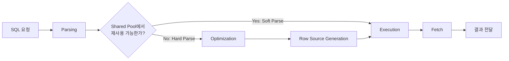
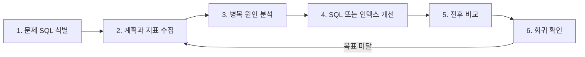

# Oracle SQL 튜닝 입문: Optimizer와 실행 계획 이해하기

문법에 맞는 SQL은 원하는 결과를 반환한다. 하지만 같은 결과를 반환하는 SQL이라도 읽는 데이터 블록 수, CPU 사용량, 메모리 사용량과 응답 시간은 크게 다를 수 있다.

예를 들어 주문 한 건을 찾는 쿼리가 정확한 결과를 반환하더라도, 매번 주문 테이블 전체를 읽는다면 데이터가 늘어날수록 문제가 된다. SQL 튜닝은 이처럼 **결과의 정확성은 유지하면서 데이터베이스가 수행하는 일을 줄이고, 측정 가능한 성능 목표를 달성하는 과정**이다.

이 글에서는 Oracle Database 21c를 기준으로 SQL이 처리되는 과정, Cost-Based Optimizer가 실행 계획을 고르는 근거, 실행 계획을 읽는 방법과 기본적인 튜닝 절차를 정리한다.

## 1. SQL 튜닝이란?

### 정확한 SQL과 효율적인 SQL

SQL 작성의 첫 번째 목표는 요구사항에 맞는 결과를 만드는 것이다. SQL 튜닝은 그다음 질문에서 시작한다.

- 필요한 행과 열만 읽고 있는가?
- 불필요한 정렬, 조인, 반복 접근이 발생하지 않는가?
- 데이터가 증가해도 목표 응답 시간을 지킬 수 있는가?
- 한 쿼리가 자원을 과도하게 점유해 다른 요청의 처리량을 떨어뜨리지 않는가?

따라서 실행 시간이 짧아졌다는 사실만으로 튜닝이 끝났다고 보기는 어렵다. Oracle SQL Tuning Guide는 SQL 튜닝을 미리 정한 성능 기준을 충족하도록 SQL 문장의 성능을 반복적으로 개선하는 과정으로 설명한다. 목표도 측정 가능해야 한다.

| 목표 | 의미 | 확인할 질문 |
| --- | --- | --- |
| Response Time | 사용자가 SQL을 요청한 시점부터 응답을 받기까지 걸린 시간 | 단일 요청이 목표 시간 안에 끝나는가? |
| Throughput | 일정 시간 동안 최소한의 자원으로 처리할 수 있는 작업량 | 같은 자원으로 더 많은 요청을 처리할 수 있는가? |

Response Time이 같더라도 원인은 다를 수 있다. 어떤 온라인 요청은 디스크 I/O를 오래 기다리고, 어떤 분석 쿼리는 CPU를 장시간 점유해 다른 세션을 방해할 수 있다. 그래서 elapsed time뿐 아니라 다음 자원 사용량을 함께 본다.

- **I/O**: 테이블과 인덱스의 데이터 블록을 얼마나 읽었는가
- **CPU**: 필터, 조인, 정렬, 집계에 얼마나 많은 연산을 사용했는가
- **Memory**: 정렬이나 Hash Join의 작업 영역이 충분했는가, 부족해서 임시 영역에 기록하지는 않았는가

튜닝의 목적은 모든 SQL에 인덱스를 적용하는 것이 아니다. 업무 목표에 맞춰 병목을 찾고, 부작용까지 포함해 더 나은 데이터 접근 방법을 선택하는 것이다.

## 2. Oracle의 SQL 처리 과정

Oracle 문서에서 SQL Processing의 주요 단계는 **Parsing → Optimization → Row Source Generation → Execution**이다. `SELECT` 결과를 애플리케이션으로 가져오는 Fetch까지 포함해 흐름을 펼치면 다음과 같다. SQL 종류에 따라 일부 단계는 생략될 수 있다.



### 2.1 Parsing

애플리케이션이 SQL 실행을 준비하도록 Parse Call을 보내면 Oracle은 Cursor를 열거나 생성하고 SQL을 분석한다.

1. **Syntax Check**: SQL 문법이 올바른지 확인한다.
2. **Semantic Check**: 테이블과 컬럼이 존재하는지, 접근 권한이 있는지 등 문장의 의미를 확인한다.
3. **Shared Pool Check**: Shared Pool의 Shared SQL Area에 재사용할 수 있는 실행 코드가 있는지 확인한다.

재사용할 수 있는 SQL을 찾으면 **Soft Parse**가 가능하다. 일반적으로 기존 실행 계획과 실행 코드를 재사용하므로 Optimization과 Row Source Generation을 건너뛴다. 반대로 재사용할 수 없다면 **Hard Parse**가 발생하며, Optimizer가 계획을 만들고 실행 가능한 형태로 생성하는 작업이 필요하다.

문자열이 같다고 항상 Soft Parse가 되는 것은 아니다. SQL이 참조하는 객체나 Optimizer 환경이 다르면 별도의 실행 코드가 필요할 수 있다. 반대로 리터럴 값만 다른 SQL을 계속 만들기보다 Bind Variable을 적절히 사용하면 재사용 가능성을 높일 수 있다.

```sql
-- 리터럴이 달라질 때마다 서로 다른 SQL 문장이 된다.
SELECT order_id FROM orders WHERE customer_id = 100;
SELECT order_id FROM orders WHERE customer_id = 200;

-- 애플리케이션에서는 바인드 변수를 사용해 SQL을 재사용할 수 있다.
SELECT order_id FROM orders WHERE customer_id = :customer_id;
```

Soft Parse도 비용이 전혀 없는 것은 아니다. 핵심은 Hard Parse가 최적화와 실행 코드 생성, Dictionary 확인 등을 동반하므로 과도하게 반복되면 CPU와 동시성에 부담을 줄 수 있다는 점이다.

### 2.2 Optimization

Hard Parse 과정에서 Query Optimizer는 SQL을 실행할 여러 후보 방법을 검토한다. 통계정보를 바탕으로 Access Path, Join Order, Join Method와 SQL 변환 후보의 비용을 추정하고, 검토한 후보 중 비용이 가장 낮은 계획을 선택한다.

### 2.3 Row Source Generation

Row Source Generator는 Optimizer가 고른 계획을 SQL Engine이 실행할 수 있는 반복 실행 프로그램으로 만든다. 각 단계가 행 집합을 만들고 상위 단계에 전달하는 **Row Source Tree**가 구성된다.

예를 들어 인덱스에서 ROWID를 찾고, ROWID로 테이블 행을 읽고, 조건에 맞는 행을 상위 연산에 전달하는 식이다. 이 트리에는 테이블 접근 순서, 접근 방식, 조인 방식, 정렬과 집계 같은 연산이 포함된다.

### 2.4 Execution과 Fetch

Execution 단계에서 SQL Engine은 Row Source Tree의 연산을 수행한다. 필요한 블록이 메모리에 없으면 스토리지에서 읽고, DML이라면 변경에 필요한 Lock과 Redo, Undo 처리도 수행한다.

Query는 실행 후 Result Set을 만들며, 클라이언트의 Fetch Call에 따라 한 행 또는 여러 행씩 전달한다. 모든 결과를 가져와야 전체 작업량을 알 수 있는 쿼리도 있고, 첫 행을 일찍 반환한 뒤 Fetch가 계속될수록 추가 작업을 수행하는 쿼리도 있다. 따라서 도구에서 첫 화면이 빨리 보였다는 사실과 전체 결과 Fetch가 끝난 시간은 구분해야 한다.

## 3. SQL Optimizer의 역할

SQL은 **무엇을 조회할지** 표현하는 비절차적 언어다. 테이블을 어떤 순서로 읽고 어떤 조인 알고리즘을 쓸지는 보통 작성자가 지정하지 않는다. Oracle의 Cost-Based Optimizer(CBO)가 후보 계획을 만들고 비교한다.

Optimizer의 판단을 이해하려면 다음 용어를 연결해서 봐야 한다.

| 용어 | 의미 | 예시 |
| --- | --- | --- |
| Access Path | 테이블의 행에 접근하는 방법 | Full Table Scan, Index Range Scan |
| Join Order | 여러 테이블을 접근하는 순서 | `orders`를 먼저 읽을지 `customers`를 먼저 읽을지 |
| Join Method | 두 Row Source를 결합하는 방법 | Nested Loops, Hash Join, Sort Merge Join |
| Optimizer Statistics | 행 수, 블록 수, 컬럼별 고유값 수와 데이터 분포 등 비용 추정의 입력 | `DBMS_STATS`로 수집한 통계 |
| Selectivity | 조건이 전체 행 중 선택할 것으로 추정되는 비율 | 100,000행 중 100행이면 약 0.001 |
| Cardinality | 실행 계획의 각 연산이 반환할 것으로 추정한 행 수 | 실행 계획의 `Rows` |
| Cost | 후보 계획의 예상 자원 사용량을 나타내는 내부 상대값 | I/O, CPU, Memory 등을 반영한 추정치 |

### Selectivity에서 Cost까지

다음 조건을 생각해보자.

```sql
SELECT order_id, order_date, amount
FROM tuning_orders
WHERE customer_id = 42;
```

`customer_id = 42`가 전체 행 중 극히 일부만 반환한다면 선택도가 높다고 표현한다. Oracle 문서의 수치 정의로는 Selectivity가 `0`에 가까운 경우다. Optimizer는 컬럼 통계와 Histogram 등을 이용해 Selectivity를 추정하고, 각 연산의 Cardinality를 계산한다.

Cardinality 추정치는 이후 비용 계산에 연쇄적으로 영향을 준다. 예를 들어 Nested Loops의 바깥쪽 Row Source가 실제보다 훨씬 적게 추정되면, 안쪽 테이블을 반복해서 조회하는 횟수도 작게 예상되어 부적절한 조인 방법을 선택할 수 있다.

> 실행 계획의 `Cost`는 실행 시간의 밀리초나 초가 아니다. 동일한 SQL과 Optimizer 환경에서 후보 계획을 비교하기 위한 내부 추정치다. 서로 다른 SQL의 Cost만 보고 어느 쪽이 더 빠르다고 결론 내릴 수 없으며, Cost가 낮아도 실제 실행은 더 느릴 수 있다.

통계가 오래되었거나 데이터 분포가 균일하지 않은데 이를 충분히 표현하지 못하면 Estimated Rows와 Actual Rows의 차이가 커질 수 있다. 실행 계획을 볼 때 연산 이름뿐 아니라 행 수 추정이 실제와 맞는지 확인해야 하는 이유다.

Oracle 버전이 바뀌면 사용할 수 있는 변환과 판단 근거가 달라져 같은 SQL이라도 다른 계획이 선택될 수 있다. 이 글의 설명과 예시는 Oracle Database 21c를 기준으로 한다.

## 4. Execution Plan 이해하기

Execution Plan은 Oracle이 SQL을 실행하기 위해 선택한 연산의 순서다. 가장 기본적인 예상 계획 확인 방법은 `EXPLAIN PLAN`과 `DBMS_XPLAN.DISPLAY`를 사용하는 것이다.

```sql
EXPLAIN PLAN FOR
SELECT *
FROM employees
WHERE department_id = 50;

SELECT *
FROM TABLE(DBMS_XPLAN.DISPLAY);
```

`EXPLAIN PLAN`은 SQL을 실제로 실행하지 않고, 설명 시점에 Optimizer가 선택한 계획을 `PLAN_TABLE`에 기록한다.

### 실행 계획의 주요 항목

| 항목 | 읽는 방법 |
| --- | --- |
| Operation | 수행할 작업이다. `TABLE ACCESS`, `INDEX`, `HASH JOIN`, `SORT` 등이 표시된다. |
| Options | Operation의 세부 방식이다. `FULL`, `RANGE SCAN`, `BY INDEX ROWID` 등이 표시된다. |
| Object Name | 접근하는 테이블이나 인덱스 이름이다. |
| Rows | 해당 연산이 반환할 것으로 Optimizer가 추정한 Cardinality다. 실제 행 수가 아니다. |
| Cost | 해당 연산까지의 예상 자원 비용이다. 실행 시간과 일대일로 대응하지 않는다. |
| Predicate Information | 어느 단계에서 조건을 접근 조건(`access`) 또는 필터 조건(`filter`)으로 적용하는지 보여준다. |

계획은 들여쓰기로 부모와 자식 관계를 표현한다. 단순히 Id 순서대로 실행된다고 보면 안 되며, 자식 Row Source가 만든 행을 부모가 소비하는 트리로 읽어야 한다. 일반적으로 안쪽의 자식 연산부터 따라가되, 조인과 Adaptive Plan처럼 구조가 복잡한 경우에는 부모-자식 관계와 활성 연산을 함께 확인한다.

### 자주 보는 접근 연산

- `TABLE ACCESS FULL`: 테이블의 모든 행을 읽고 조건에 맞지 않는 행을 걸러낸다.
- `INDEX RANGE SCAN`: B-Tree 인덱스에서 조건에 해당하는 키 범위를 순서대로 탐색하고 ROWID를 얻는다.
- `TABLE ACCESS BY INDEX ROWID`: 인덱스에서 얻은 ROWID로 테이블 블록에 접근해 필요한 컬럼을 읽는다. 21c 계획에서는 여러 ROWID를 묶어 접근하는 경우 `BATCHED`가 함께 표시될 수 있다.

아래 형태라면 먼저 인덱스에서 조건에 맞는 ROWID를 찾고, 그 ROWID로 테이블 행을 읽는 흐름이다.

```text
TABLE ACCESS BY INDEX ROWID  TUNING_ORDERS
  INDEX RANGE SCAN          IDX_TUNING_ORDERS_CUSTOMER
```

### 예상 계획과 실제 계획은 다를 수 있다

`EXPLAIN PLAN`은 **설명 시점의 예상 계획**이다. 실제 실행 환경의 Bind Variable 값과 타입, 세션 파라미터, 통계, 스키마 등이 다르면 실제 Cursor가 사용한 계획과 달라질 수 있다.

실제로 수행한 SQL의 계획은 `DBMS_XPLAN.DISPLAY_CURSOR`로 확인한다.

```sql
SELECT /*+ GATHER_PLAN_STATISTICS */
       order_id, order_date, amount
FROM tuning_orders
WHERE customer_id = 42;

SELECT *
FROM TABLE(
    DBMS_XPLAN.DISPLAY_CURSOR(NULL, NULL, 'ALLSTATS LAST +PREDICATE')
);
```

`ALLSTATS LAST`는 마지막 실행의 I/O·메모리 관련 실행 통계를 계획과 함께 보여준다. 환경과 권한에 따라 `V$SQL`, `V$SQL_PLAN`, `V$SQL_PLAN_STATISTICS_ALL`에 대한 조회 권한이 필요하다. 이 출력에서 `E-Rows`와 `A-Rows`를 비교하면 Optimizer의 예상 행 수와 실제 행 수 차이를 찾을 수 있다.

실행 계획의 연산 하나만으로 SQL이 잘 튜닝되었는지는 판단할 수 없다. 전체 Row Source Tree, Predicate, 예상/실제 행 수, Buffer 접근량과 실행 횟수를 함께 봐야 한다.

## 5. Full Table Scan과 Index Scan

### Full Table Scan

Full Table Scan은 테이블 전체를 읽은 뒤 조건에 맞지 않는 행을 제거한다. 이름만 보면 무조건 피해야 할 것 같지만 다음 상황에서는 합리적인 선택일 수 있다.

- 테이블이 작다.
- 조건에 맞는 행이 전체의 큰 비율을 차지한다.
- 사용할 수 있는 인덱스가 없다.
- 인덱스를 읽고 ROWID로 테이블을 반복 접근하는 비용이 전체 스캔보다 크다.
- 인덱스 컬럼에 함수를 적용해 일반 인덱스를 사용할 수 없거나, 복합 인덱스의 선두 컬럼 조건이 없다.

### B-Tree Index와 Index Range Scan

B-Tree 인덱스는 정렬된 키와 해당 테이블 행의 ROWID를 저장한다. `customer_id = 42`, `order_date BETWEEN ...`처럼 인덱스 선두 컬럼의 한 값 또는 범위를 찾을 때 Index Range Scan 후보가 될 수 있다.

```sql
CREATE INDEX idx_tuning_orders_customer
    ON tuning_orders (customer_id);
```

Index Range Scan은 Root와 Branch를 거쳐 시작 Leaf Block을 찾고, 조건 범위의 Leaf Block을 따라가며 ROWID를 얻는다. 조회 컬럼이 인덱스에 모두 들어 있지 않다면 이후 ROWID로 테이블을 읽는다.

### 인덱스가 있어도 사용하지 않는 이유

다음 두 쿼리는 같은 테이블을 조회하지만 선택도가 다르다.

```sql
-- 고객이 충분히 많고 분포가 고르면 일부 행만 선택할 가능성이 크다.
SELECT *
FROM tuning_orders
WHERE customer_id = 42;

-- 대부분의 주문이 PAID라면 테이블의 큰 비율을 선택할 수 있다.
SELECT *
FROM tuning_orders
WHERE order_status = 'PAID';
```

첫 번째 조건은 Index Range Scan이 유리할 수 있다. 두 번째 조건처럼 많은 행을 반환하면 인덱스 블록과 테이블 블록을 오가는 것보다 Full Table Scan이 더 저렴할 수 있다. 인덱스가 있어도 Optimizer는 비용이 더 낮다고 추정한 다른 경로를 선택한다.

인덱스는 조회 비용만 줄이는 구조도 아니다. 저장 공간을 사용하고 `INSERT`, `UPDATE`, `DELETE` 때 함께 유지해야 한다. 따라서 “Full Table Scan 발견 → 인덱스 생성”을 공식처럼 적용하지 말고, 데이터 분포와 실제 작업량을 측정해야 한다.

## 6. SQL 튜닝의 기본 절차

Oracle SQL Tuning Guide의 흐름을 실무에서 반복하기 쉬운 여섯 단계로 정리하면 다음과 같다.



### 1. 성능 문제가 발생한 SQL 식별

느리다는 인상만으로 시작하지 않는다. 응답 시간, 실행 횟수, 누적 CPU, Buffer Gets, Disk Reads 등에서 부하 비중이 큰 SQL을 찾고 목표를 정한다.

### 2. 현재 실행 계획 및 성능 지표 수집

SQL Text, Bind 값, 실제 실행 계획, `A-Rows`, `Buffers`, 실행 횟수와 경과 시간 등 재현에 필요한 기준선을 남긴다. 테이블·인덱스 정의와 통계정보의 수집 시점도 확인한다.

### 3. 병목 원인 분석

- 예상 행 수와 실제 행 수가 크게 다른가?
- 많은 행을 읽은 뒤 대부분을 Filter에서 버리는가?
- 같은 Row Source가 예상보다 많이 반복 실행되는가?
- 불필요한 Sort나 Cartesian Join이 있는가?
- 통계정보가 없거나 오래되었는가?
- SQL 문제가 아니라 I/O, CPU, Lock 대기 같은 시스템 문제인가?

### 4. SQL 및 인덱스 개선

원인에 맞는 가설을 세운다. 불필요한 행과 컬럼을 줄이거나, Predicate를 인덱스가 활용할 수 있는 형태로 바꾸거나, 필요한 인덱스를 설계할 수 있다. 변경 범위는 문제 범위에 맞춰야 한다. 한 SQL의 문제를 해결하려고 시스템 전체 Optimizer 설정을 바꾸면 다른 SQL에 회귀가 생길 수 있다.

### 5. 개선 전후 성능 비교

같은 데이터와 Bind 값, 유사한 Cache 상태와 동시성 조건에서 비교한다. 계획이 바뀌었다는 사실만 보지 말고 실제 Buffer Gets, Disk Reads, CPU와 elapsed time, 반환 행 수를 함께 확인한다.

### 6. 성능 회귀 여부 확인

특정 값에서는 빨라졌지만 다른 값에서는 느려지지 않았는지, 인덱스 추가로 DML 비용과 저장 공간이 지나치게 늘지 않았는지 확인한다. 데이터 증가, 통계 갱신, 배포나 버전 변경 뒤 계획이 바뀔 가능성도 모니터링한다.

튜닝은 “인덱스를 추가했더니 빨라졌다”로 끝나는 작업이 아니다. **가설 → 변경 → 같은 조건에서 측정 → 회귀 확인**을 반복해 근거를 남기는 작업이다.

## 7. 실습: 인덱스 유무에 따른 실행 계획 비교

다음 실습은 Oracle Database 21c에서 별도 샘플 스키마 없이 실행할 수 있도록 구성했다. 100,000건의 주문 이력을 만들고, 1,000명의 고객에게 주문을 균등하게 배분한다. `customer_id = 42`는 약 100건을 선택하도록 만든 조건이다.

> 행 수가 적거나 저장 환경이 다르면 Optimizer가 인덱스 생성 후에도 Full Table Scan을 선택할 수 있다. 아래 실습은 계획 변경을 보장하는 예제가 아니라, 같은 SQL의 계획과 실제 통계를 비교하는 절차다.

### 7.1 테스트 테이블과 샘플 데이터 생성

```sql
CREATE TABLE tuning_orders (
    order_id      NUMBER        NOT NULL,
    customer_id   NUMBER        NOT NULL,
    order_date    DATE          NOT NULL,
    order_status  VARCHAR2(10)  NOT NULL,
    amount        NUMBER(12, 2) NOT NULL,
    CONSTRAINT pk_tuning_orders PRIMARY KEY (order_id)
);

INSERT INTO tuning_orders (
    order_id,
    customer_id,
    order_date,
    order_status,
    amount
)
SELECT LEVEL,
       MOD(LEVEL - 1, 1000) + 1,
       DATE '2025-01-01' + MOD(LEVEL - 1, 365),
       CASE
           WHEN MOD(LEVEL, 100) = 0 THEN 'CANCELLED'
           WHEN MOD(LEVEL, 10) = 0 THEN 'PENDING'
           ELSE 'PAID'
       END,
       ROUND(MOD(LEVEL * 137, 500000) / 100 + 10, 2)
FROM dual
CONNECT BY LEVEL <= 100000;

COMMIT;
```

`LEVEL`과 `MOD`만 사용하므로 실행할 때마다 고객별 행 수와 상태 분포가 동일하다. 실제 서비스 데이터의 분포를 재현한 것은 아니며, 접근 경로 비교를 위한 인공 데이터다.

### 7.2 통계정보 수집

```sql
BEGIN
    DBMS_STATS.GATHER_TABLE_STATS(
        ownname    => USER,
        tabname    => 'TUNING_ORDERS',
        cascade    => TRUE,
        method_opt => 'FOR ALL COLUMNS SIZE AUTO'
    );
END;
/
```

Optimizer가 현재 행 수와 컬럼 정보를 비용 계산에 사용할 수 있도록 통계를 수집한다. 실습처럼 데이터를 한 번에 넣은 직후에는 통계 수집 전후 계획이 달라질 수 있다.

### 7.3 인덱스가 없는 상태의 예상 계획

```sql
EXPLAIN PLAN SET STATEMENT_ID = 'BEFORE_INDEX' FOR
SELECT order_id, order_date, amount
FROM tuning_orders
WHERE customer_id = 42;

SELECT *
FROM TABLE(DBMS_XPLAN.DISPLAY(NULL, 'BEFORE_INDEX', 'TYPICAL +PREDICATE'));
```

`customer_id` 인덱스가 아직 없으므로 이 환경에서는 `TABLE ACCESS FULL`이 유력하다. 다만 출력되는 `Rows`와 `Cost`는 자신의 환경에서 확인해야 하며, 이 글에서는 측정하지 않은 숫자를 제시하지 않는다.

### 7.4 인덱스가 없는 상태의 실제 실행 통계

```sql
SELECT /*+ GATHER_PLAN_STATISTICS */
       order_id, order_date, amount
FROM tuning_orders
WHERE customer_id = 42;

SELECT *
FROM TABLE(
    DBMS_XPLAN.DISPLAY_CURSOR(NULL, NULL, 'ALLSTATS LAST +PREDICATE')
);
```

조회 결과를 끝까지 Fetch한 뒤 계획을 확인한다. `Starts`, `E-Rows`, `A-Rows`, `Buffers`, `Reads` 등 출력되는 값을 비교표에 기록한다. 클라이언트가 결과 일부만 가져오면 실행 통계도 전체 Fetch 기준과 달라질 수 있다.

### 7.5 인덱스 생성과 통계 갱신

```sql
CREATE INDEX idx_tuning_orders_customer
    ON tuning_orders (customer_id);

BEGIN
    DBMS_STATS.GATHER_TABLE_STATS(
        ownname    => USER,
        tabname    => 'TUNING_ORDERS',
        cascade    => TRUE,
        method_opt => 'FOR ALL COLUMNS SIZE AUTO'
    );
END;
/
```

`cascade` 매개변수를 `TRUE`로 지정해 테이블과 관련 인덱스 통계를 함께 수집한다.

### 7.6 인덱스 생성 후 계획과 실제 통계

```sql
EXPLAIN PLAN SET STATEMENT_ID = 'AFTER_INDEX' FOR
SELECT order_id, order_date, amount
FROM tuning_orders
WHERE customer_id = 42;

SELECT *
FROM TABLE(DBMS_XPLAN.DISPLAY(NULL, 'AFTER_INDEX', 'TYPICAL +PREDICATE'));

SELECT /*+ GATHER_PLAN_STATISTICS */
       order_id, order_date, amount
FROM tuning_orders
WHERE customer_id = 42;

SELECT *
FROM TABLE(
    DBMS_XPLAN.DISPLAY_CURSOR(NULL, NULL, 'ALLSTATS LAST +PREDICATE')
);
```

선택도가 충분히 높다고 판단하면 다음과 같은 연산 조합이 나타날 수 있다. 이는 **가능한 형태를 설명한 것**이며 실제 측정 출력이 아니다.

```text
TABLE ACCESS BY INDEX ROWID [BATCHED]  TUNING_ORDERS
  INDEX RANGE SCAN                    IDX_TUNING_ORDERS_CUSTOMER
```

확인할 핵심은 인덱스 사용 여부 하나가 아니다.

- `E-Rows`와 `A-Rows`가 비슷한가?
- 같은 결과 행 수를 반환했는가?
- `Buffers`와 물리 읽기량이 어떻게 달라졌는가?
- 계획의 각 단계가 몇 번 시작(`Starts`)되었는가?
- 여러 번 실행해도 같은 경향이 나타나는가?

### 7.7 데이터 분포에 따른 계획 차이 확인

실습 데이터의 90%는 `PAID` 상태다. 다음 쿼리를 위한 `order_status` 인덱스를 추가하더라도 많은 행을 반환하므로 Full Table Scan이 더 낮은 비용으로 추정될 수 있다.

```sql
CREATE INDEX idx_tuning_orders_status
    ON tuning_orders (order_status);

BEGIN
    DBMS_STATS.GATHER_TABLE_STATS(
        ownname    => USER,
        tabname    => 'TUNING_ORDERS',
        cascade    => TRUE,
        method_opt => 'FOR ALL COLUMNS SIZE AUTO'
    );
END;
/

EXPLAIN PLAN SET STATEMENT_ID = 'LOW_SELECTIVITY' FOR
SELECT order_id, order_date, amount
FROM tuning_orders
WHERE order_status = 'PAID';

SELECT *
FROM TABLE(DBMS_XPLAN.DISPLAY(NULL, 'LOW_SELECTIVITY', 'TYPICAL +PREDICATE'));
```

이 결과는 “인덱스가 있는데 왜 사용하지 않는가?”라는 질문에 답하는 좋은 비교가 된다. 인덱스 존재 여부가 아니라 **해당 값이 선택하는 행의 비율과 전체 예상 비용**이 Access Path 결정에 영향을 준다.

### 7.8 결과 비교표

실제 환경에서 확인한 값을 다음 표에 기록한다. 실행 시간은 Cache 상태와 클라이언트 Fetch 방식의 영향을 받으므로 한 번의 값만으로 결론 내리지 않는다.

| 구분 | Plan Hash Value | 주요 Access Path | E-Rows | A-Rows | Buffers | Reads | 전체 Fetch 경과 시간 |
| --- | --- | --- | ---: | ---: | ---: | ---: | ---: |
| 고객 인덱스 생성 전 |  |  |  |  |  |  |  |
| 고객 인덱스 생성 후 |  |  |  |  |  |  |  |
| 상태 인덱스 + `PAID` |  |  |  |  |  |  |  |

### 7.9 실습 객체 정리

```sql
DROP TABLE tuning_orders PURGE;
```

테이블을 삭제하면 테이블에 속한 인덱스와 제약조건도 함께 제거된다. 공유 개발 환경에서는 다른 사용자가 실습 객체를 사용하지 않는지 확인한 뒤 실행한다.

## 8. 정리

SQL 튜닝을 처음 공부할 때는 실행 계획의 `INDEX`라는 단어를 찾는 데 집중하기 쉽다. 하지만 더 중요한 것은 Oracle이 어떤 근거로 데이터 접근 방식을 선택했고, 그 추정이 실제 실행과 얼마나 일치하는지 이해하는 것이다.

- **SQL 튜닝은 데이터 접근 방식과 실행 과정을 이해하는 작업이다.** 결과가 정확한 SQL도 불필요한 I/O, CPU, Memory를 사용할 수 있다.
- **Optimizer의 판단 근거를 이해하면 실행 계획을 분석할 수 있다.** Statistics에서 출발한 Selectivity와 Cardinality 추정이 Access Path, Join Order, Join Method와 Cost에 영향을 준다.
- **튜닝의 핵심은 가설을 세우고 계획과 성능 지표로 검증하는 것이다.** 인덱스나 SQL을 변경하기 전 기준선을 수집하고, 같은 조건에서 개선 효과와 회귀를 확인해야 한다.

다음 학습 주제로는 B-Tree 인덱스의 구조를 더 자세히 살펴보고, 복합 인덱스에서 컬럼 순서와 선두 컬럼이 Access Path에 어떤 영향을 주는지 정리할 예정이다.

## 참고 자료

- [Oracle Database 21c SQL Tuning Guide - Introduction to SQL Tuning](https://docs.oracle.com/en/database/oracle/oracle-database/21/tgsql/introduction-to-sql-tuning.html)
- [Oracle Database 21c SQL Tuning Guide - SQL Processing](https://docs.oracle.com/en/database/oracle/oracle-database/21/tgsql/sql-processing.html)
- [Oracle Database 21c SQL Tuning Guide - Query Optimizer Concepts](https://docs.oracle.com/en/database/oracle/oracle-database/21/tgsql/query-optimizer-concepts.html)
- [Oracle Database 21c SQL Tuning Guide - Explaining and Displaying Execution Plans](https://docs.oracle.com/en/database/oracle/oracle-database/21/tgsql/generating-and-displaying-execution-plans.html)
- [Oracle Database 21c SQL Tuning Guide - Optimizer Access Paths](https://docs.oracle.com/en/database/oracle/oracle-database/21/tgsql/optimizer-access-paths.html)
- [Oracle Database 21c PL/SQL Packages and Types Reference - DBMS_XPLAN](https://docs.oracle.com/en/database/oracle/oracle-database/21/arpls/DBMS_XPLAN.html)
